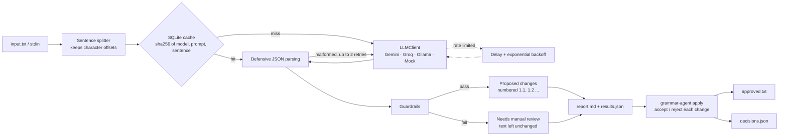

# grammar-agent

**grammar-agent** is a command-line tool that uses a large language model (LLM) to check the spelling and grammar of a text file, one sentence at a time. It never edits your text on its own. Each proposed change comes with a plain-English explanation written for language learners. The tool then checks the model's answer: if the answer is malformed, changes the meaning, rewrites instead of correcting, or edits text it did not explain, that sentence is flagged for manual review and left exactly as written. You get a numbered review report, accept or reject each change in the terminal, and only the changes you approve reach `approved.txt`. Every decision is logged in `decisions.json`, so you can audit the run. It runs at no cost: on Google Gemini's free tier, on Groq's free tier, or fully offline with Ollama. A SQLite cache means re-running the same text makes no API calls.

## Architecture



The two commands share a **run directory**:

| File | Written by | Contents |
|---|---|---|
| `results.json` | `check` | The source text and every checked sentence, as machine-readable data |
| `report.md` | `check` | The human-readable review report |
| `decisions.json` | `apply` | Every accept/reject decision, who made it (`human` or `auto`), and which sentences were left unchanged |
| `approved.txt` | `apply` | The original text with only the accepted changes applied |

## Setup

You need **Python 3.11 or newer**. If your system Python is older, [uv](https://docs.astral.sh/uv/) can install a newer one for this project.

### 1. Install

```bash
git clone https://github.com/msell587/grammar-agent.git && cd grammar-agent
```

```bash
uv venv --python 3.12 .venv && source .venv/bin/activate
```

```bash
uv pip install -e ".[dev]"
```

Without uv, use `python3.12 -m venv .venv`, then `source .venv/bin/activate`, then `pip install -e ".[dev]"`.

### 2. Get a free Gemini API key (default provider)

1. Go to [Google AI Studio](https://aistudio.google.com/apikey) and sign in with a Google account.
2. Click **Create API key**. No credit card is needed for the free tier.
3. Copy the key.

### 3. Configure `.env`

```bash
cp .env.example .env
```

Open `.env` and paste your key after `GEMINI_API_KEY=`. `.env` is listed in `.gitignore`, so the key is never committed. The code reads keys only from the environment and sends them only in HTTP headers, never in URLs.

Settings are read from the first of these that exists, and real environment variables always win:

1. the file named by `GRAMMAR_AGENT_ENV_FILE`, if set;
2. `./.env` in the folder you run the command from;
3. `~/.config/grammar-agent/.env`, a private per-user file. Use this one for a global install, so your keys never sit inside a project folder:

```bash
mkdir -p ~/.config/grammar-agent && cp .env ~/.config/grammar-agent/.env && chmod 600 ~/.config/grammar-agent/.env
```

The response cache lives in `~/.cache/grammar-agent/` by default.

**Free-tier limits change.** The default model is `gemini-3.5-flash`. Each model has its own free quota, and the newest models can be very small: on the account this was tested with, `gemini-3.8-flash` allowed only 20 requests per day, and older models such as `gemini-2.5-flash` are not offered to new accounts. The default `GRAMMAR_AGENT_REQUEST_DELAY` of 6.5 seconds spaces requests to about 9 per minute. If you see HTTP 404, 429 or 503 errors, check the [current limits](https://ai.google.dev/gemini-api/docs/rate-limits) and change `GEMINI_MODEL` in `.env`. Sentences that hit these errors are flagged rather than lost, and rerunning `check` only calls the model for sentences that are not already cached.

**Privacy.** On the free tier, Google may use what you send to improve its products. Don't send private or confidential text. Use Ollama for that.

### Switching provider

The provider is one setting. Change `GRAMMAR_AGENT_PROVIDER` in `.env`, or pass `--provider` on the command line.

| Provider | Cost | Setup |
|---|---|---|
| `gemini` (default) | Free tier | `GEMINI_API_KEY` from Google AI Studio |
| `groq` | Free tier | `GROQ_API_KEY` from [console.groq.com/keys](https://console.groq.com/keys) |
| `ollama` | Free, fully local | Install [Ollama](https://ollama.com), then run `ollama pull llama3.1:8b` |
| `mock` | Free, offline | No setup needed. Replays scripted replies (for tests and demos) |

Adding another provider means writing one small class with a `model_id` property and a `complete(system, user, schema=None) -> str` method. `schema` defaults to the grammar check's answer format; other tools built on grammar-agent can pass their own JSON schema to get a different kind of answer. See `src/grammar_agent/llm/groq.py` (about 40 lines).

## Usage

```bash
grammar-agent check input.txt --out ./run1
```

```bash
grammar-agent apply ./run1
```

`check` reads a `.txt` file (or stdin if you pass `-` or nothing), writes `report.md`, and changes nothing. Read the report first. `apply` then asks about each numbered change:

```
y = accept   n = reject   a = accept this and the rest of this sentence   q = quit
```

If you quit, or press Ctrl-C or Ctrl-D, **nothing is written**. A change can reach `approved.txt` only through an explicit decision.

Useful options:

| Option | Meaning |
|---|---|
| `--level beginner\|intermediate\|advanced` | Reading level of the explanations (default `intermediate`, about CEFR B1). Also `GRAMMAR_AGENT_LEVEL` |
| `--provider`, `--model` | Override `.env` for one run |
| `--delay SECONDS` | Pause between uncached requests |
| `--max-length-ratio 0.3` | Rewrite guardrail threshold (see below) |
| `--no-cache`, `--cache PATH` | Skip the cache, or use a different cache file |
| `--force` | Overwrite an existing run (`check`) or existing decisions (`apply`) |
| `apply --accept IDS --reject IDS` | Non-interactive decisions, for example `--accept all --reject 2.1,4.1` or `--accept 1.1,1.2 --reject all`. The two lists must cover every change, so nothing is accepted by leaving it out. Recorded as `"decided_by": "human"` with `"mode": "explicit-ids"` |
| `apply --auto-approve` | Non-interactive: accept every change that passed the guardrails. Each decision is recorded as `"decided_by": "auto"`. Flagged sentences still stay unchanged |
| `-v` | Debug logging (for example, malformed replies and retries) |

### Install globally

To run `grammar-agent` from any folder, install it as a tool and put your keys in `~/.config/grammar-agent/.env` (see above):

```bash
uv tool install --python 3.12 --editable .
```

`--editable` means later changes to this folder take effect without reinstalling.

### Use it from Claude Code

A [Claude Code skill](https://docs.claude.com/en/docs/claude-code/skills) can drive the tool from a chat. Ask "grammar-check my-essay.txt", or type `/grammar-check my-essay.txt`. Claude runs `check`, shows you the numbered changes, asks which to accept, then runs `apply --accept … --reject …` with exactly your answer. Your keys stay hidden from Claude:
- The skill instructions forbid reading or printing any `.env` file, and `grammar-agent` loads the keys itself.
- Permission deny rules in `~/.claude/settings.json` block Claude Code from opening the key files at all:

```json
"permissions": {
  "deny": [
    "Read(~/.config/grammar-agent/.env)",
    "Edit(~/.config/grammar-agent/.env)",
    "Bash(cat ~/.config/grammar-agent/.env*)"
  ]
}
```

The skill lives in `~/.claude/skills/grammar-check/SKILL.md`, outside this repository.

## Example run

[`examples/sample.txt`](examples/sample.txt):

```text
Their going to the libary tomorow. Me and him has finished the report, but we forgot to sent it. The meeting is on Tuesday.

Its a good idea, isnt it? The results was better then we expected.
```

You can reproduce the committed example in [`examples/sample_run/`](examples/sample_run) without any API key. It uses the mock provider with the scripted replies in [`examples/demo_replies.json`](examples/demo_replies.json). One of those replies is deliberately bad, to show a guardrail catching it:

```bash
grammar-agent check examples/sample.txt --out ./demo --provider mock --mock-script examples/demo_replies.json
```

To check the same file with the real model, run:

```bash
grammar-agent check examples/sample.txt --out ./run1
```

```text
Checking sample.txt with mock:mock ...
[1/5] 3 change(s) proposed
[2/5] NEEDS MANUAL REVIEW
[3/5] no changes
[4/5] 2 change(s) proposed
[5/5] 2 change(s) proposed

Checked 5 sentences: 7 change(s) proposed, 1 flagged for manual review.
```

A snippet of the generated [`report.md`](examples/sample_run/report.md):

> | | |
> |---|---|
> | Sentences checked | 5 |
> | Changes proposed | 7 (in 3 sentences) |
> | Sentences flagged for manual review | 1 |
>
> ### Sentence 1: 3 changes
>
> **Changes:** ~~Their~~**They're**<sup>[1.1]</sup> going to the ~~libary~~**library**<sup>[1.2]</sup> ~~tomorow~~**tomorrow**<sup>[1.3]</sup>.
>
> - **[1.1]** *grammar*: `Their` → `They're`. 'Their' means 'belonging to them'. Here you need 'they're', which is short for 'they are'.
> - **[1.2]** *spelling*: `libary` → `library`. 'Library' has an 'r' after the 'b'. Many people forget it because it is often not pronounced clearly.
>
> ### Sentence 2: needs manual review
>
> **Model suggestion (rejected, not offered for approval):**
>
> He and I have completed the report, but we neglected to send it.
>
> **Why it was flagged:**
>
> - the listed changes do not produce the model's corrected sentence (the model made edits it did not explain)

After accepting everything except **[5.2]** (`then` → `than`), [`approved.txt`](examples/sample_run/approved.txt) is:

```text
They're going to the library tomorrow. Me and him has finished the report, but we forgot to sent it. The meeting is on Tuesday.

It's a good idea, isn't it? The results were better then we expected.
```

Sentence 2 is unchanged because it was flagged, and "then" stays because that change was rejected. The paragraph break is preserved because changes are applied at their exact character positions in the original file.

## How the AI output is constrained and verified

An LLM is good at spotting errors but tends to "help" too much: it rephrases, swaps in words it likes better, or quietly fixes things it never mentions. grammar-agent treats every answer as a *proposal to be checked*, not a result to be trusted.

**1. A narrow instruction.** The system prompt allows spelling, grammar and punctuation fixes only. It forbids changing meaning, tone, style or word choice, asks for the smallest possible edit, and says that text which is already correct must come back unchanged. The sentence is wrapped in `<sentence>` tags, and the model is told to treat it as text to check, never as instructions to follow.

**2. A fixed answer format.** The model must reply with a JSON object in a fixed schema: `original`, `corrected`, `meaning_preserved`, and a list of `changes`, each with a span, a replacement, a type, a category and an explanation. The category names the kind of mistake from a fixed list (verb tense, articles, prepositions, subject-verb agreement and so on), so other tools can track which mistakes a learner repeats; a missing or unknown category becomes `other` without a retry. Gemini and Ollama enforce the schema while generating, and Groq uses JSON mode. The temperature is 0, so answers are as repeatable as the provider allows.

**3. Defensive parsing with retries.** The reply is still parsed as if it could be anything. Markdown code fences and stray prose are stripped. A missing field, a wrong type or broken JSON counts as a failure, and the model is asked again (up to 2 more times) with the error message included. After three failures, the sentence is flagged instead of crashing the run.

**4. Guardrails on the content.** A correction is offered to you only if it passes every check below. Otherwise the sentence is marked **needs manual review**, its text is left exactly as written, and the report lists every reason.

| Check | What it catches |
|---|---|
| `meaning_preserved` is `false` | The model itself admits the meaning may have changed |
| Each `original_span` must appear **verbatim** in the sentence | Invented or misquoted text, so a change can't be pinned to a real location |
| Changes must not overlap | Contradictory edits |
| Length guardrail: the corrected sentence may not differ in length by more than 30% **and** more than 12 characters | Rewrites. The 12-character floor means a small real fix in a short sentence, such as `Its` → `It's`, is not rejected |
| Applying the listed changes must reproduce `corrected` **exactly** | Silent edits the model made but did not list or explain (the example above) |
| The model's copy of `original` must match the input | Answers about the wrong sentence |
| Every change needs an explanation | Unexplained edits |

**5. A human decides.** The output is not built from the model's `corrected` text. It is built from **your original text** plus only the changes you accepted, each applied at its recorded character position. Before writing anything, `apply` checks that every reviewable change has exactly one decision. It also confirms that each change still matches the source text. Flagged sentences are never modified, even with `--auto-approve`.

## Development

```bash
pytest
```

```bash
ruff check . && ruff format --check . && mypy
```

**In VS Code:** open the folder and install the recommended extensions when prompted. The `.venv` interpreter is selected automatically, and tests appear in the Testing panel. `Terminal → Run Task…` offers Test, Lint + type check, the offline demo, a live check and a review. The Run and Debug panel has launch configs for `check` and `apply`, so you can set breakpoints in the pipeline.

The tests cover sentence splitting, JSON parsing and retries, each guardrail, applying approved changes, the cache, rate-limit backoff, the report and the CLI. They use `MockClient`, plus `httpx.MockTransport` for the HTTP layer, so they make **no network calls** and finish in well under a second. mypy runs in `--strict` mode over both the source code and the tests.

```
src/grammar_agent/
  cli.py          check / apply commands
  splitter.py     sentence splitter (known weaknesses documented inside)
  prompts.py      system prompt, explanation levels, response JSON schema
  parsing.py      defensive JSON parsing
  guardrails.py   checks on each correction
  checker.py      cache -> LLM -> parse/retry -> guardrails, per sentence
  cache.py        SQLite response cache
  ratelimit.py    request spacing and exponential backoff with jitter
  report.py       report.md
  review.py       interactive approval
  apply.py        decisions -> approved.txt + decisions.json
  run.py          run-directory format
  llm/            LLMClient protocol and Gemini, Groq, Ollama, Mock clients
```

## Limitations and next steps

**What it cannot do:**

- **It checks one sentence at a time.** Errors that span sentences go unnoticed: tense consistency across a paragraph, a pronoun whose referent is in the previous sentence, or repeated words across a sentence boundary.
- **The guardrails catch rewrites, not wrong corrections.** A change that is short, explained and verbatim-located but simply *wrong* (for example, "fixing" correct British spelling to American) passes every check. That's why a human approves each change, and why the explanations matter.
- **The model can miss errors.** A sentence reported as "no changes" is not proof that it is correct. LLMs also vary between runs and between providers, even at temperature 0.
- **`meaning_preserved` is self-reported.** It catches only the cases the model admits to. The length and consistency checks are the real backstop.
- **Insertions need context.** A missing comma must be expressed as replacing a span (for example `However` → `However,`). If the model returns an empty `original_span`, the sentence is flagged rather than guessed at.
- **The sentence splitter is simple by design.** Unlisted abbreviations, unusual quoting, inline lists and hard-wrapped headings can split or merge sentences wrongly. These cases are documented at the top of `splitter.py` and pinned by a test.
- **It reads plain text only.** It is English-focused and reads UTF-8 `.txt` input. Windows `\r\n` line endings come out as `\n` in `approved.txt`. Markdown, HTML and code blocks are treated as prose.
- **Free tiers are slow on long texts.** The default 6.5-second delay means about 9 sentences per minute on the first run. Reruns are instant because of the cache.

**Next steps:**

- Send the neighbouring sentences as read-only context, to catch cross-sentence errors without allowing edits there.
- Add a second "verifier" pass, possibly with a different model, that votes on each change, and record agreement in the report.
- Build an evaluation set of sentences with known corrections, to measure precision and recall per provider and per prompt version.
- Support resuming an interrupted review, and editing a replacement during review instead of only accepting or rejecting it.
- Process sentences in parallel within the provider's rate limit.
- Accept Markdown input and skip code blocks.
